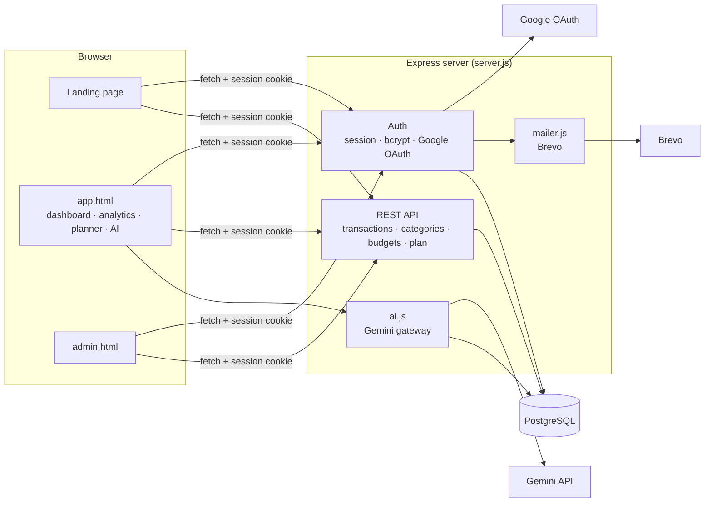
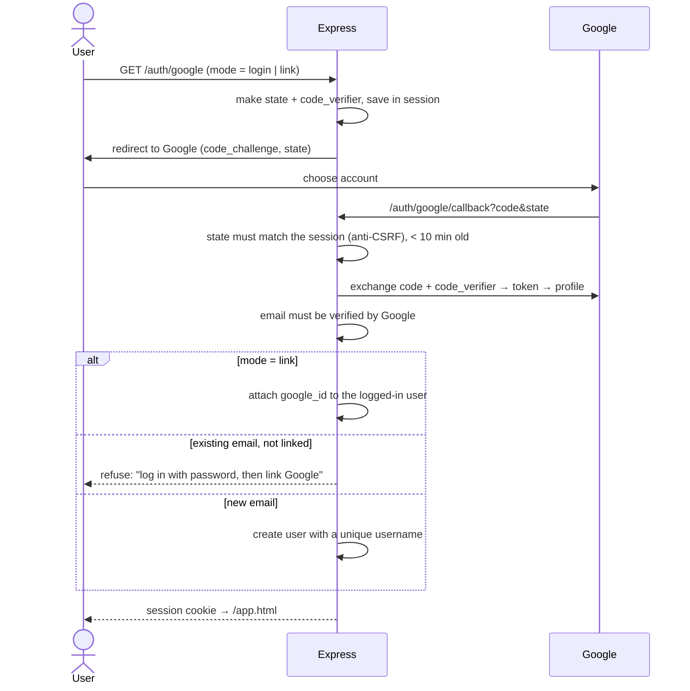
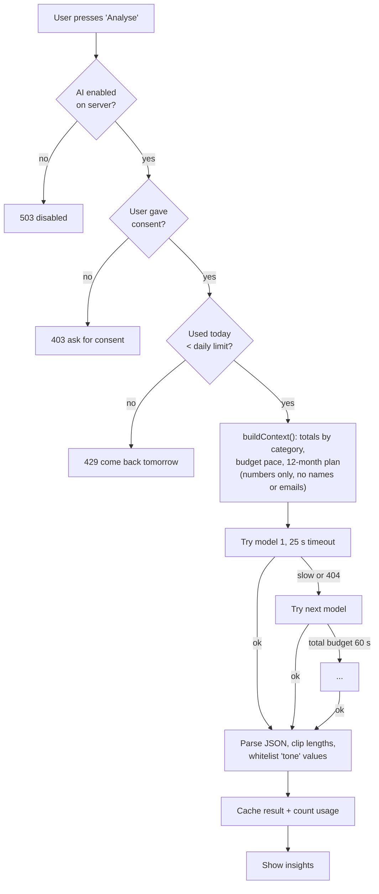
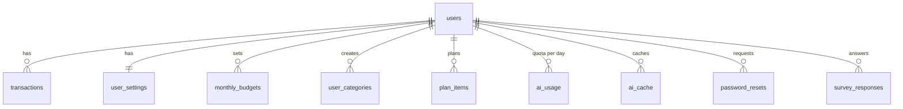

# MoneyMate: a personal finance app for university students, with an AI assistant

> แอปจัดการเงินสำหรับนักศึกษา: บันทึกรายรับรายจ่าย ตั้งงบรายเดือน วางแผนการเงินล่วงหน้า 12 เดือน และผู้ช่วย AI ที่วิเคราะห์การใช้เงินให้

**Live:** https://moneymate-ral8.onrender.com · **Pitch deck:** [moneymate-deck](https://github.com/naphatphong/moneymate-deck) · **Survey dashboard:** [moneymate-dashboard](https://github.com/naphatphong/moneymate-dashboard)

Most students get money from home, a part-time job or a scholarship, and run out before the month ends.
MoneyMate answers three questions: **Where did my money go? Will it last this month? Am I OK for the next 12 months?**

`Node.js` · `Express` · `PostgreSQL` · `Session auth + bcrypt` · `Google OAuth 2.0 (PKCE)` · `Gemini API` ·
`Brevo (email)` · `Vanilla JS` · `Render`

---

## Highlights

| | |
|---|---|
| **Auth I built from scratch** | Register / login with bcrypt, server sessions, Google login (OAuth 2.0 + PKCE, no library), account linking, password reset by email |
| **Security decisions** | Reset tokens stored only as SHA-256 hashes, 30-min single use; the same reply whether an email exists or not; rate limits; `state` check against CSRF on OAuth; secure httpOnly cookies |
| **AI with guardrails** | Consent first, daily quota per user, only aggregated numbers sent (no names or emails), multi-model fallback with timeouts, cached results |
| **Forecasting logic** | The planner simulates the balance day by day for 12 months, from recurring income and expenses |
| **Full product loop** | Landing page → app → admin panel → in-app survey → separate analytics dashboard + pitch deck |

---

## How I thought about it

### 1. Architecture



**Why vanilla JS + Express?** One server serves both the static pages and the API, so there's one deploy
(Render), no build step, and the whole flow from click to SQL is easy to follow.

### 2. Auth flows and the "why" behind each rule

**Google login (OAuth 2.0 authorization code + PKCE, written by hand):**



> **Why not link accounts automatically by email?** Sign-up doesn't verify email. Someone could register
> with *your* email first, wait for you to "log in with Google", and get linked to your account. So linking
> only happens from inside an account you've already proved you own.

**Forgot password:**

| Rule | Why |
|---|---|
| Same reply whether the email exists or not, sent *before* any work | Nobody can use the form to find out who has an account |
| Token = 32 random bytes; DB keeps only `sha256(token)` | A leaked database can't be used to reset passwords |
| Expires in 30 min, works once | Limits the damage from a forwarded or old email |
| Link built from `APP_URL`, never the `Host` header | Stops host-header injection that would send links to an attacker's domain |
| Rate limit: 5 / 15 min per IP, 3 / hour per email | No email bombing |

### 3. The AI assistant: useful, private and affordable



Decisions:

- **Only call the AI when the user presses the button.** Opening the page shows the cached result, so it
  costs nothing.
- **Never trust model output:** strip ```` ```json ```` fences, fall back to the outermost `{...}`, clip every
  field, and whitelist enum values before they reach the UI.
- **Remember the model that works** and skip it again if it gets slow, so one slow model doesn't make
  every user wait.
- If a model rejects the "no thinking" setting, retry the same model without it instead of failing.

### 4. The 12-month planner

Users enter expected income and expenses (daily, weekly, monthly or one-off). The planner then:

1. Starts from the **real balance today** (opening balance + every transaction up to now).
2. Walks **day by day from tomorrow** for 12 months, adding plan items that fall on each day plus any real
   transactions dated in the future.
3. Reports, for each month, whether money lasts, what's left, and **the first day the balance goes negative**.

A day-by-day walk was easier to get right than monthly averages, because "monthly on the 25th" and "weekly"
items land on different days in different months.

### 5. Data model



Every user-owned table references `users` with `ON DELETE CASCADE` and uses `CHECK` / `UNIQUE` constraints
(`type IN ('income','expense')`, `amount > 0`, one budget per user per month), so the database rejects bad data. The schema migrates itself at startup
(`CREATE TABLE / ALTER TABLE ... IF NOT EXISTS`), so a fresh database or an old one both just work.

---

## Features

- **Transactions:** income and expenses, built-in and custom categories
- **Budgets:** a monthly budget per month, warnings at 80% and over budget
- **Analytics:** 30D / 90D / 6M / 1Y / all-time charts, all computed in the browser from loaded data
- **Planner:** 12-month cash-flow forecast
- **AI assistant:** monthly insights, budget advice, chat, AI-drafted plan (Thai / English)
- **Accounts:** password or Google, link/unlink Google, forgot password by email
- **Admin:** user stats, roles, test email
- **Survey:** an in-app questionnaire feeding the [analytics dashboard](https://github.com/naphatphong/moneymate-dashboard)
- Dark / light / system theme with a custom accent colour

## Run it locally

```bash
npm install
cp .env.example .env      # set DATABASE_URL and SESSION_SECRET (everything else is optional)
npm start                 # http://localhost:3000
npm run seed:demo         # optional: a demo student account with a year of sample data
```

Optional features turn on when you set their keys in `.env` (see the comments there):
`BREVO_API_KEY` (email), `GOOGLE_CLIENT_ID/SECRET` (Google login), `GEMINI_API_KEY` (AI).
Without email set up, reset links print to the server console in development.

## Project structure

| File | What it does |
|---|---|
| `server.js` | Express app: session, auth, REST API, AI routes, admin |
| `database.js` | PostgreSQL pool, schema migration at startup, all queries |
| `googleAuth.js` | Google OAuth 2.0 + PKCE without a library |
| `ai.js` | Gemini gateway: model fallback, timeouts, JSON parsing, context builder |
| `mailer.js` | Brevo email + readable error explanations |
| `public/` | Landing, app, admin and auth pages (vanilla JS modules in `public/js/`) |
| `scripts/seed-demo.js` | Demo data |

## What I'd do next

- Automated tests (Jest + Supertest) for auth and the planner maths
- Move rate limits from memory to Postgres or Redis so they survive restarts and multiple instances
- Split `server.js` into route modules, and add input validation with a schema (zod)
- Port the frontend to a component framework as the app grows
